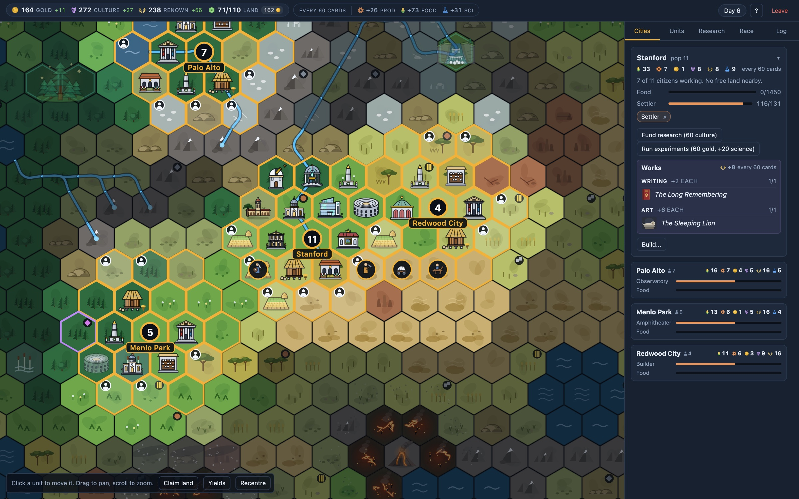
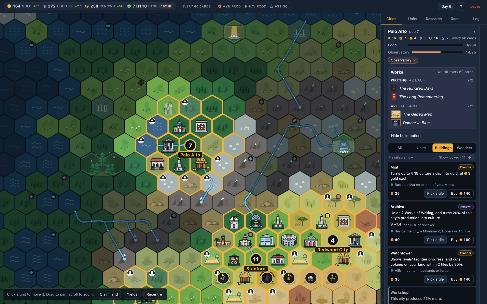
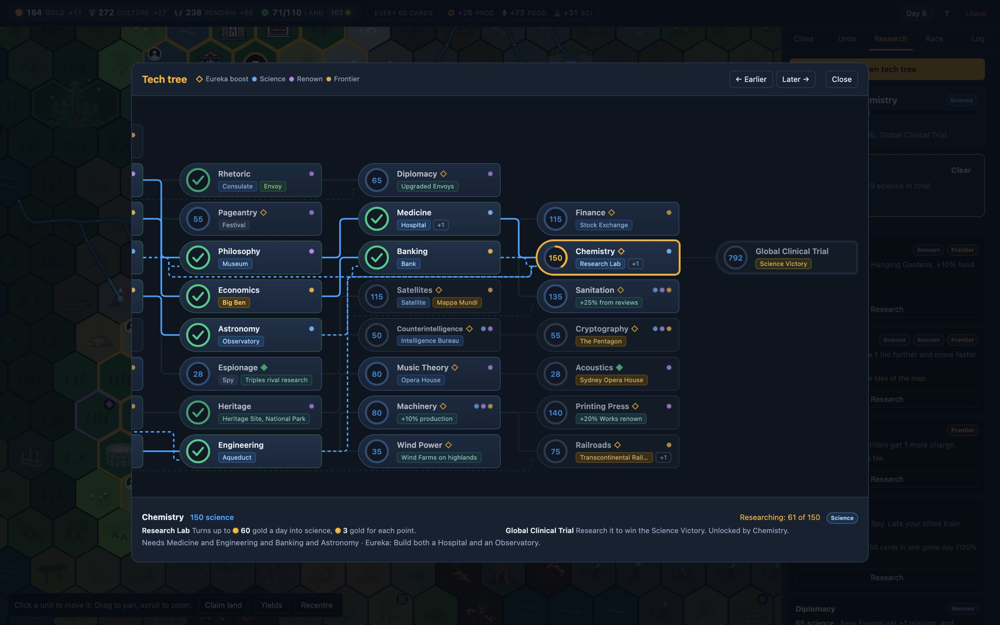
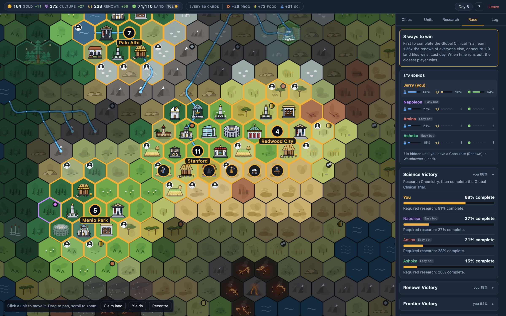
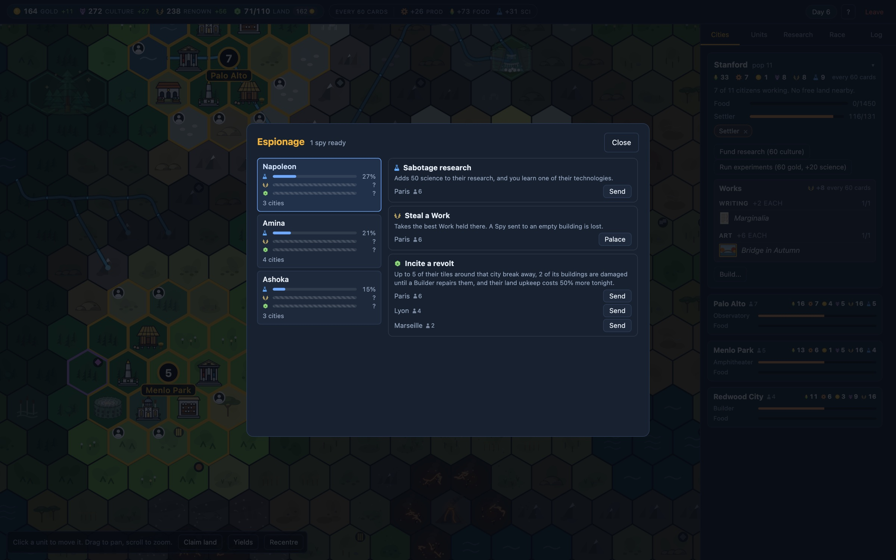
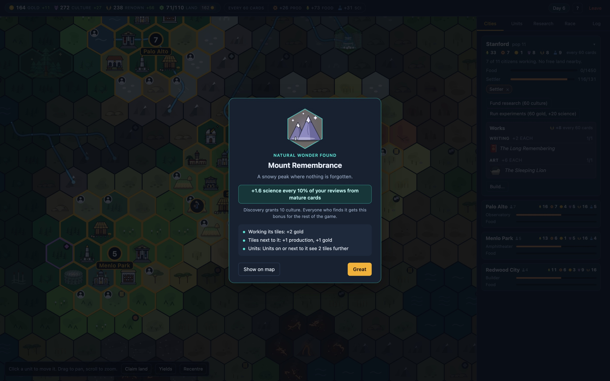
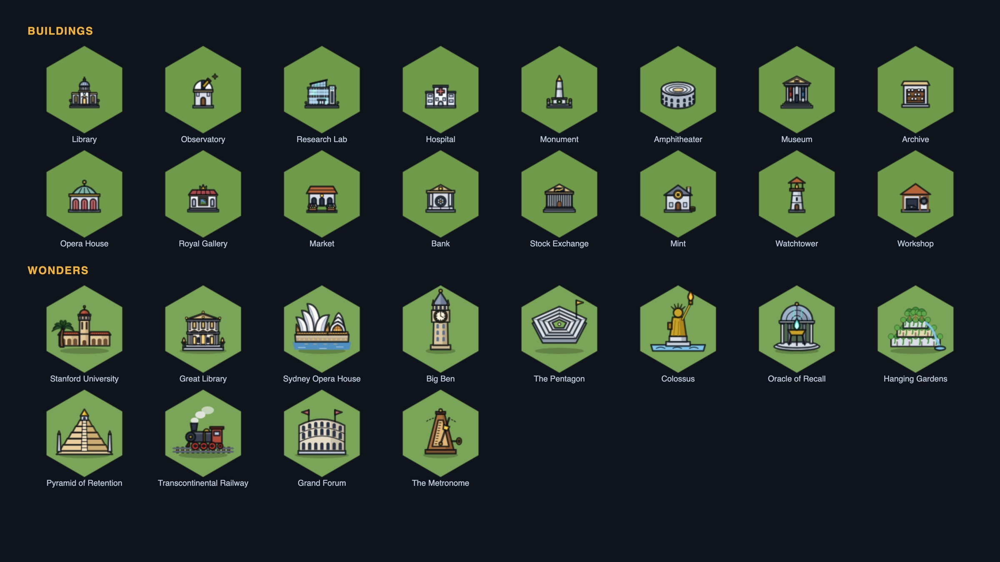

# Realm Empires

**Every review builds your empire.** A Civilization-style strategy game for Anki.



This repository is the game's website (GitHub Pages). It is plain HTML: `index.html`, the
screenshots in `images/`, and the add-on package in `downloads/`.

## Publish it on GitHub Pages

1. Create an empty repository on GitHub, for example `realm-empires`.
2. From this folder:

   ```bash
   git init -b main
   git add .
   git commit -m "Realm Empires site"
   git remote add origin https://github.com/<you>/realm-empires.git
   git push -u origin main
   ```

3. On GitHub, open **Settings → Pages**, set **Source** to *Deploy from a branch*, branch
   `main`, folder `/ (root)`, and save. The site appears at
   `https://<you>.github.io/realm-empires/` within a minute or two.

## Updating

- New version: replace the file in `downloads/` and update the two download links in
  `index.html` (search for `.ankiaddon`).
- New screenshots: replace the JPEGs in `images/` with the same names.

## Screenshots

| | |
|---|---|
|  |  |
|  |  |
|  |  |


